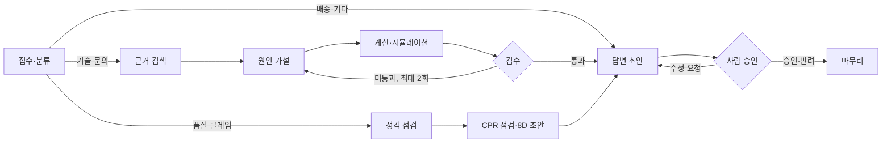
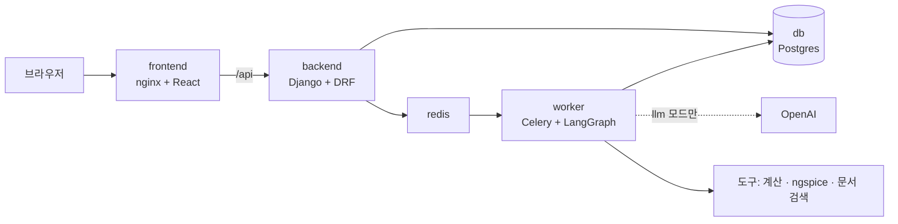

# FAE Agent — 반도체 고객 기술 문의 처리 에이전트

반도체 부품 회사(TI 가정)에 들어온 고객 기술 문의를 **접수·분류 → 근거 검색 → 원인 가설 → 계산·시뮬레이션 검증 → 검수 → 답변 초안 → 사람 승인**까지 처리하는 개인 프로젝트입니다.
에이전트는 LangGraph로 연결하고, 도구(계산, ngspice, 문서 검색, 티켓)는 MCP 서버로 노출했으며, 승인 화면이 있는 웹 앱(Django + React + Docker)으로 실행됩니다.

**English summary.** FAE Agent drafts replies to customer technical inquiries about semiconductor parts (TI assumed).
It classifies an inquiry, retrieves evidence from datasheets, proposes root-cause hypotheses, verifies them with design-formula calculations and ngspice simulations,
lets a rule-based reviewer check the evidence and the tests (including a cross-check of calculation against simulation), and stops for human approval before anything is sent.
It was evaluated on 51 synthetic inquiries: 44 about six real TI parts (two LDOs, two buck converters, two op-amps) whose limits were transcribed from the datasheets, and 7 about fictional demo parts.
Honest result: root-cause accuracy is on par with a plain LLM; the value is datasheet-grounded answers with computed numbers, correction of wrong customer assumptions, and an auditable review step.
Datasheet PDFs are not in this repository (TI terms of use, see [docs/data_policy.md](docs/data_policy.md)).

## 무엇을 하나

고객이 "LMV321A로 이득 10 증폭기를 만들었는데 200 kHz에서 출력이 절반만 나온다"고 문의하면:

1. 부품(LMV321A)과 증상, 동작 조건(Rf 9 kΩ, Rg 1 kΩ, 200 kHz, 0.2 Vpp)을 읽고 기술 문의로 분류합니다.
2. 데이터시트에서 GBW 1 MHz, 슬루율 1.7 V/µs 같은 근거를 찾습니다 (쪽수 포함 출처).
3. 원인 가설을 세우고 **계산**(이득 10이면 폐루프 대역폭 100 kHz, 200 kHz에서 이득 4.472배, 출력 0.894 Vpp)과 **ngspice 시뮬레이션**(같은 조건, 4.472배)으로 두 가지 방법으로 재현합니다. 두 결과가 0.005 %로 일치했다고 검수가 알려 줍니다.
4. 슬루율은 원인이 아니라는 것(필요 슬루율 0.56 V/µs < 규격 1.7 V/µs)까지 계산으로 가려냅니다.
5. 근거와 계산 숫자가 붙은 답변 초안을 만들고, **사람이 승인·수정 요청·반려**한 뒤에야 처리가 끝납니다.

품질 클레임("타 버렸으니 반품해 달라")은 고객이 알려 준 값을 데이터시트의 절대 최대·권장 범위와 수치로 비교합니다. 예를 들어 LM2596에 48 V를 걸었다면 절대 최대 45 V(권장 40 V) 초과를 출처와 함께 답에 붙이고, 반품 절차와 자료 요청은 그대로 안내합니다.

**범위**: 메인은 기술 문의형(발진, 과열, 리플·노이즈, 출력 이상, 기동 실패 등)입니다. 대부분 고객의 회로 설계나 사용 조건 문제라서 문서·계산·시뮬레이션으로 풀 수 있습니다. 품질 클레임은 CPR 자료 점검과 8D 초안까지, 배송·기타는 분류해서 넘기는 답변 초안까지만 합니다 ([docs/scope.md](docs/scope.md)).

## 측정 결과 (성공과 실패를 모두 적었습니다)

실제 TI 부품 6종(LDO 2, 벅 2, 연산증폭기 2)의 데이터시트에서 한계·특성 값을 직접 옮긴 부품 카드를 만들고, 가상 고객 문의 51건(실제 부품 44건 + 가상 부품 7건)에 정답 근거를 붙여 평가했습니다. 문의는 실제 고객 데이터가 아니라 직접 작성한 것입니다.

| 측정 | 결과 |
| --- | --- |
| 가능성 검증 (3종, 문의 32건) | 원인 적중은 **도구 없는 LLM과 같거나 낮음** (쉬운 문의 1순위 15/18 대 15/18, 구체적 문의 7/10 대 9/10). 정답 숫자가 답에 나온 비율은 11/18 대 4/18. 비용은 약 24배 |
| 새 부품 3종 (문의 12건) | 분류 12/12, 원인 1순위 6/9, 품질 클레임 정격 초과 판정 3/3, 정답 숫자 16/28 |
| 연산증폭기 계산 대 ngspice | 이득 4.472배 대 4.472배 (차이 0.005 %), 대역폭 100 kHz 대 99.99 kHz |

- **결론**: 이 시스템의 가치는 원인을 더 잘 맞히는 것이 아니라 (그렇지 않았습니다), 데이터시트 근거와 계산 숫자가 붙은 초안을 만들고, 고객의 틀린 전제("IQ가 25 nA면 전류 여유가 많다", "LM358은 레일 투 레일")를 부품 카드로 정정하고, 사람이 승인하기 전에 검수가 테스트의 질을 확인하는 데 있습니다.
- **알려진 한계**: 새 부품 측정에서 검수 미통과가 3건 나왔는데, 세 건 모두 값 대조 테스트의 합격 범위 방향을 틀린 채 재분석 3번을 다 썼습니다. 슬루율이 진짜 원인인 문의에서는 답변 본문은 맞았지만 원인 후보 목록에는 빠졌고, "IC가 죽는다"는 서지 문의는 품질 클레임 경로로 가서 서지 32 V와 절대 최대 30 V를 비교하지 못했습니다.
- 문의 작성자, 시스템 조정자, 채점자가 같은 사람이고 표본이 작아서 통계적 결론이 아니라 **탐색적 결과**입니다.

상세 결과와 원자료: [가능성 검증 보고서](docs/feasibility_report.md), [진행 보고서](docs/progress_report_2026-09-30.md), `docs/feasibility/results/`

## 흐름



| 단계 | 하는 일 | 도구 |
| --- | --- | --- |
| 접수·분류 | 부품 번호·증상·동작 조건 추출, 경로 결정 (기술→FAE, 불량 의심→반품, 배송→고객지원) | tickets |
| 근거 검색 | 데이터시트 조각, 과거 사례, 부품 스펙 카드 검색 | kb |
| 원인 가설 | 가설 3개 + 해결책 + 테스트 계획 | kb |
| 계산·시뮬레이션 | 설계 공식 11종, ngspice 회로 3개(부하 스텝, 연산증폭기 주파수 응답, 벅 스위칭 리플)로 **증상 재현(reproduce)**과 **해결책 확인(verify)** | calc, spice |
| 검수 | 근거 인용, 테스트의 질(자기 참조·무의미한 기대 범위·부품에 안 맞는 도구), 정격 초과, 계산과 시뮬레이션 교차 확인. 문제가 있으면 원인 가설로 되돌림 | — |
| 정격 점검 | 품질 클레임의 고객 값을 부품 카드의 한계와 수치 비교 | kb |
| CPR 점검 | 반품 필수 자료(A-B-A 교차 검증, 마킹 사진, 회로도 등), 8D 초안 | — |
| 답변 | 경로에 맞는 고객 답변 초안과 내부 메모 | — |

검수 규칙과 재분석 규칙은 [docs/architecture.md](docs/architecture.md)의 표에 있습니다. 검수는 규칙 기반이라 결과가 항상 같고 비용이 없습니다.

## 구성



- 그래프 실행(수십 초 + 사람 승인 대기)은 요청 안에서 돌리지 않고 Celery 작업자가 하며, 단계마다 진행 상태를 Postgres에 저장합니다. 서버를 재시작해도 승인 대기 중인 실행이 이어집니다.
- **mock 모드**는 API 키 없이 규칙만으로 전체 흐름이 돌고(토큰 0, 테스트용), **llm 모드**는 접수·조사·원인 분석·답변을 OpenAI가 처리합니다. 계산·검수·승인은 두 모드가 같습니다.
- 도구는 항상 `ToolGateway`를 거쳐 호출합니다. 기본은 함수 직접 호출(`TOOL_MODE=local`)이고, `TOOL_MODE=mcp`면 MCP 서버(stdio)로 호출합니다.
- 접근 보호: nginx 비밀번호, 문의 접수 분당 10회 제한, 하루 토큰 상한(llm 모드). HTTP에서는 비밀번호가 읽히므로 인터넷에 열려면 HTTPS가 필요합니다.

## 시작하기

### 1. 로컬 (키 없이, mock 모드)

```bash
git clone https://github.com/tjdgns8343-skn-family-ai-33/TI_AUTOMATION.git
cd TI_AUTOMATION
conda create -n ti_project python=3.12 -y
conda activate ti_project
pip install -r requirements.txt
python -m fae_agent.cli check
python -m pytest
python -m fae_agent.cli run --file data/samples/complaint_ldo_overheating.txt --decision a
```

- Windows에서는 `.env` 없이도 동작하고, 설정을 바꾸려면 `copy .env.example .env` 후 편집합니다.
- `run`은 사람 승인 단계에서 멈추고 승인(a) / 수정 요청(r) / 반려(x)를 묻습니다. 입력을 줄 수 없는 곳에서는 `--decision a`, `--decision r,a --comment "..."`, `--decision x`를 붙입니다.
- 테스트는 코어 149개입니다. ngspice가 없으면 시뮬레이션 관련 19개는 건너뛰고 나머지 130개가 통과합니다. 백엔드 테스트 15개는 `cd backend && python -m pytest`로 실행합니다 (Redis·Postgres 없이).
- LLM 모드(`FAE_MODE=llm`)에서는 `run`·`eval`이 모델을 불러 요금이 나가므로 `--allow-llm`을 붙여야 실행됩니다 (안 붙이면 거부).
- 다른 명령: `python -m fae_agent.cli eval`(평가셋 전체를 자동 승인으로 실행), `ingest`(문서 색인 다시 만들기), `tickets`(처리한 티켓 목록).
- Streamlit 개발 화면: `streamlit run app/streamlit_app.py`

### 2. 실제 데이터시트 넣기

저장소에는 TI 데이터시트 PDF와 그 색인이 **없습니다** (TI 이용약관: 개인·비상업 다운로드는 허용하지만 자동 수집은 금지). 부품 카드(`data/parts/*.yaml`)는 들어 있어서 정격 점검은 바로 동작하지만, 문서 근거 검색까지 쓰려면:

1. TI 사이트에서 데이터시트를 **직접 내려받아** `data/raw/docs/`에 소문자 부품 번호 파일 이름으로 넣습니다: `tps7a20.pdf`, `tps7a02.pdf`, `lm2596.pdf`, `tps54331.pdf`, `lmv321a.pdf`, `lm358.pdf`
2. `python -m fae_agent.cli ingest`로 색인을 만듭니다 (PDF가 많아 몇 분 걸립니다).
3. 새 부품을 넣으려면 `data/parts/`의 카드 형식으로 한계 값을 옮기고, 값마다 데이터시트 쪽수를 적습니다.

### 3. 웹 앱 (Docker)

Docker Desktop을 켜고 저장소 루트에서 실행합니다. 웹 앱 이미지는 문서 색인이 필요하므로 위 2번을 먼저 해야 합니다.

```bash
docker compose up -d --build
```

- 화면: <http://localhost:8080> (예시 문의를 고르고 분석 시작 → 진행 단계, 결과, 차트, 승인 버튼) · API 문서: <http://localhost:8080/api/docs/>
- 기본은 mock 모드라 OpenAI 요금이 나가지 않습니다. 접속 비밀번호는 `docker/compose.local.env`(깃 제외)에 `FAE_BASIC_AUTH_USER`, `FAE_BASIC_AUTH_PASSWORD`를 적으면 켜집니다.
- 끄기: `docker compose down` (데이터 유지) / 데이터까지 지우기: `docker compose down -v`
- Docker 없이 개발: `cd backend && python manage.py migrate && python manage.py runserver`, `cd frontend && npm install && npm run dev`

### 4. LLM 모드

`.env`에 `FAE_MODE=llm`, `LLM_MODEL=openai:gpt-5.4-mini`, `OPENAI_API_KEY=...`를 적습니다. 웹 앱에서 `docker-compose.llm.yml`을 겹쳐 실행하면 루트 `.env`의 `OPENAI_API_KEY`를 작업자 컨테이너에만 넘깁니다. 문의 한 건에 기술 문의는 약 1.2만~3.1만 토큰, 품질 클레임은 약 3.5천 토큰이 들었습니다 (재분석 횟수에 따라 달라짐).

### ngspice와 MCP (선택)

- **ngspice**: 없어도 전체 흐름은 돌고 시뮬레이션 단계만 생략됩니다. <https://ngspice.sourceforge.io/download.html>에서 받아 `.env`의 `NGSPICE_PATH`에 실행 파일 경로를 적습니다 (Windows는 콘솔용 `ngspice_con.exe`). TI의 암호화된 SPICE 모델은 PSpice for TI 전용이라 쓰지 않고, 데이터시트 값으로 만든 단순 회로만 씁니다.
- **MCP 모드**: `TOOL_MODE=mcp`로 두면 도구를 MCP 서버로 호출합니다 (`langchain[mcp]`의 베타 API 사용). 서버만 따로 띄우려면 `python -m fae_agent.mcp_servers.calc_server`. 웹 앱과 측정은 `local` 모드로 돌았고 MCP 경유 실행은 선택 사항입니다.

## 저장소 구조

```text
fae_agent/            파이썬 패키지
  agents/             접수, 조사, 원인 분석, 테스트 실행, 검수, 답변, CPR, 증상별 규칙(mock)
  tools/              계산 11종, ngspice, 문서 검색, 티켓, ToolGateway(직접 호출/MCP 전환)
  mcp_servers/        도구를 MCP 서버(calc, kb, spice, tickets)로 노출
  graph.py            LangGraph 조립 (재분석 루프, 사람 승인)
backend/              Django + DRF API, Celery 작업자, 티켓·실행·승인 모델, 테스트
frontend/             React(Vite, TypeScript) 화면: 진행 단계, 승인, 시뮬레이션 파형·주파수 응답 차트
docker/, docker-compose*.yml   이미지와 전체 스택 (llm 모드는 별도 덮어쓰기 파일)
circuits/             ngspice 회로 템플릿 (lc_load_step, opamp_ac, buck_switch)
data/parts/           부품 스펙 카드 (실제 6종 + 가상 3종, 데이터시트 쪽수 표기)
data/eval/            평가 문의 61건 (실제 부품 54 + 가상 부품 7, 정답과 데이터시트 근거 포함). 벅 스위칭 5건은 측정하지 않았고, 어려운 복합 문의 5건은 각각 1회 측정 ([결과](docs/hard_cases_2026-10-02.md))
data/samples/         데모 문의와 가상 문서
docs/                 설계 문서, 검증·진행 보고서, docs/feasibility/ 실행기와 원자료
tests/                코어 pytest
```

## 데이터 이용 원칙

- TI 데이터시트·에라타·앱노트는 직접 내려받아 쓰고 저장소에 올리지 않습니다. 스크래핑·크롤링 코드도 없습니다.
- E2E 포럼은 크롤링하지 않고, 읽은 내용을 자기 말로 요약한 사례 카드만 씁니다. 실제 고객 이름·연락처는 넣지 않습니다.
- `EXAMPLE-*` 부품과 샘플 문서는 가상 데이터입니다.

자세한 내용은 [docs/data_policy.md](docs/data_policy.md).

## 현재 상태와 다음 단계

- [x] LangGraph 흐름, 검수·재분석 규칙, mock·llm 모드, MCP 서버
- [x] 실제 TI 부품 6종 카드와 평가 문의 51건, 측정과 보고서
- [x] 웹 앱 (Django + React + Docker), 사람 승인, 티켓 저장, nginx 비밀번호와 접수 제한
- [x] 계산과 ngspice 시뮬레이션 교차 확인 (연산증폭기, 벅 리플과 연속/불연속 전도 판정)
- [ ] AWS 배포 (EC2 한 대 + Docker Compose, HTTPS)
- [ ] 검수 개선: 값 대조 방향 규칙, 슬루율 가설 강제, 무의미한 기대 범위 지적, 전류 제한 여유와 잰 리플의 설계 점검 (구현, 수정 후 재측정 전)
- [ ] 손상(damage) 문의의 서지·절대 최대 비교, 팀원 블라인드 문의 평가
- [ ] 검색을 임베딩 + 벡터 DB로 교체, 회로 템플릿 추가 (벅 출력 리플 등)

## 문서

[아키텍처와 검수 규칙](docs/architecture.md) · [범위](docs/scope.md) · [데이터 이용 원칙](docs/data_policy.md) · [기획안](docs/proposal.md) · [가능성 검증 보고서](docs/feasibility_report.md) · [진행 보고서](docs/progress_report_2026-09-30.md) · [어려운 문의 측정](docs/hard_cases_2026-10-02.md) · [개선 로드맵](docs/roadmap.md)
